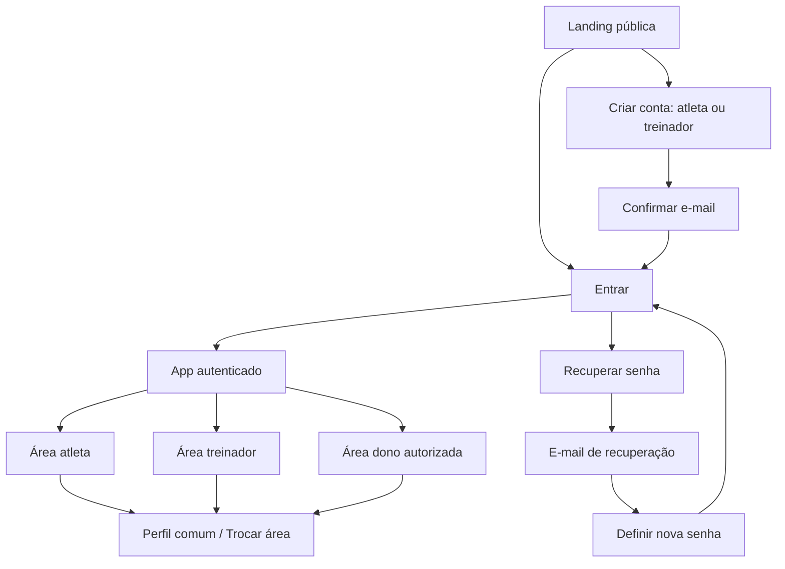

# Atlas Run — revisão de experiência e próximos ciclos

Status: UX-01 implementada; UX-02 e UX-03 entregues em 14/10/2026. SMTP ativo, confirmação/recuperação validadas e perfil completo comum às áreas. UX-04 a UX-06 permanecem planejadas.

Este documento organiza as mudanças pedidas após a sprint 4. As sprints UX-01 a UX-06 têm numeração própria para preservar o roteiro original 5, 6 e 7. Conta única, landing, acesso/recuperação e perfil completo já foram implementados. SMTP Brevo próprio e modelos estão ativos; confirmação e recuperação foram entregues e validadas pelo dono, que entrou com nova conta de treinador. Calendário mensal e revisão do registro continuam nas próximas entregas.

## 1. Objetivo e direção do produto

O Atlas Run caminha para uma plataforma de acompanhamento de treinos: o atleta recebe seu plano e relata a execução; o treinador organiza, publica e acompanha; o dono administra a operação. Primeiro vamos tornar essa experiência confiável e simples no celular. Depois avaliamos biblioteca, equipes independentes e venda de assinaturas.

O primeiro lançamento será um piloto da operação atual, com vínculos administrados pelo dono. Oferecer o produto para várias assessorias independentes exige uma etapa posterior de isolamento por equipe. Uma landing page pública e o cadastro de treinadores, sozinhos, não significam que essa estrutura já existe.

### Diagnóstico do problema de treinador

Na versão atual, os papéis são exclusivos. A tela Equipe elimina candidatos que sejam administradores, treinadores ou tenham qualquer plano ou rascunho como atleta. O banco também impede a promoção de quem já tem planos. Portanto, alterar apenas o seletor não resolveria o problema.

A leitura realizada nesta revisão encontrou quatro contas no serviço de autenticação, três perfis no app, um treinador cadastrado e nenhum candidato elegível sob essas restrições. Uma conta ainda não tem perfil no app. Esses números são um retrato da consulta, não uma regra permanente.

Referências locais: filtro em `management.js`, regras de gestão e atividades em `schema-v3.sql`, formulário de acesso em `app.js` e tratamento do retorno do e-mail em `auth-callback.js`.

### Referências de mercado

O desenho de acesso toma como referência o [login do Final Surge](https://www.finalsurge.com/login?device=desktop), que apresenta e-mail, senha, recuperação e criação de conta em uma tela própria. Seu [cadastro](https://www.finalsurge.com/signup) também começa pela escolha atleta/treinador e informa que um treinador pode usar a plataforma nas duas funções. Isso apoia a proposta de uma identidade com duas áreas; o Atlas terá sua própria interface e regras de acesso.

A [apresentação do TrainingPeaks](https://www.trainingpeaks.com/free-trainingpeaks-account/) serve como referência para uma página pública que explica o produto antes do cadastro. A [recuperação do Strava](https://support.strava.com/en-us/articles/15401976-forgot-your-password) exemplifica a jornada de solicitar o e-mail e definir uma nova senha pelo link recebido.

## 2. Uma conta, várias áreas

**Decisão proposta:** atleta e treinador são áreas cumulativas da mesma conta. O cadastro escolhe a experiência inicial. E-mail, senha, identidade, foto e dados pessoais continuam os mesmos ao trocar de área.

- Quem começa como atleta pode ativar a área de treinador depois, preservando seus treinos e registros.
- Quem começa como treinador pode abrir a área de atleta, inclusive para receber planos de outro treinador.
- O seletor **Trocar área** fica no menu do perfil e mostra a área atual no cabeçalho. A troca não exige sair ou entrar novamente.
- A área do dono aparece somente para quem já possui esse privilégio. Admin nunca será opção no cadastro público.
- Duas contas existentes com e-mails diferentes permanecem distintas. Este ciclo não funde contas nem transfere históricos entre elas.

### Ativação e permissões

Um cadastro confirmado como treinador abre sua área de gestão vazia. O dono também pode ativar essa área para uma conta existente. Na operação do piloto, o dono continua responsável por vincular atletas e treinadores. Um treinador recém-cadastrado não vê a lista geral de usuários ou planos alheios.

Ativar a segunda área pelo próprio perfil usa um comando validado pelo servidor. Não haverá escrita direta de privilégios pelo navegador. Uma área de treinador desativada pelo dono fica identificada como desativada e não pode ser reativada pelo usuário para contornar essa decisão.

Desativar o treinador retira seu acesso de gestão e preserva sua conta, área pessoal, registros e autoria histórica. Revogar um vínculo retira apenas o acesso àquele atleta. Trocar a área visível nunca cria vínculos nem altera permissões.

| Ação | Área atleta | Área treinador ativa | Área dono |
|---|---|---|---|
| Alterar dados pessoais e acesso | próprios | próprios | próprios |
| Ver plano e histórico pessoal | sim | pela área atleta | pela área atleta, se usada |
| Registrar ou corrigir execução | própria | pela área atleta, somente própria | pela área atleta, somente própria |
| Ver planos e relatos de terceiros | não | atletas vinculados | atletas da operação |
| Criar, importar e publicar treinos | não | atletas vinculados | atletas da operação |
| Editar relato de outra pessoa | não | não | não |
| Comentar treinos acompanhados | não | atletas vinculados | atletas da operação |
| Administrar usuários e vínculos | não | não | sim |
| Conceder privilégio de dono | não | não | provisionamento protegido |

O relato pertence ao atleta mesmo quando ele também é treinador ou dono. O novo modelo não concede automaticamente o direito de prescrever para si; o acesso pessoal como atleta pode receber planos pela gestão autorizada. Publicados, versões, sessões, registros e comentários continuam vinculados aos mesmos identificadores.

### Nova tela do dono: Usuários

Lista pesquisável com nome, e-mail para identificação pelo dono, áreas disponíveis, situação da confirmação e situação de treinador. Filtros: Todos, Atletas, Treinadores e Pendências. Uma pessoa pode aparecer em mais de um filtro.

No detalhe: **Ativar área de treinador**, **Desativar gestão** e **Gerenciar vínculos**. Quem já é treinador aparece como ativo/inativo; quem tem histórico de atleta continua elegível. Conta sem perfil aparece como pendência identificada, com regularização segura, em vez de desaparecer do seletor. O dono não define nem visualiza senhas.

O perfil passa a ser provisionado de forma idempotente no fluxo autorizado de cadastro/primeiro acesso. Confirmar e entrar não deve exigir salvar o formulário de Perfil para a pessoa existir na gestão. A escolha inicial de área não pode ser usada para conceder admin.

A consulta de contas sem perfil, e-mails e situação de confirmação deve ocorrer por uma operação protegida que verifica o dono no servidor e retorna somente os campos necessários. A chave pública do app não receberá acesso geral ao cadastro de autenticação; nenhuma chave administrativa será colocada no navegador.

## 3. Três experiências separadas

Rotas abaixo são um desenho de navegação, não arquivos ou funcionalidades já criadas.

| Destino | Conteúdo e comportamento |
|---|---|
| `/` | Apresentação pública; botões Entrar e Criar conta. Com sessão válida, também Abrir meu app. |
| `/entrar` | Formulário exclusivo de login. |
| `/criar-conta` | Formulário exclusivo de cadastro e escolha da área inicial. |
| `/verifique-seu-email` | Instrução de confirmação e reenvio com limite. |
| `/recuperar-senha` | Solicitação de link por e-mail. |
| `/redefinir-senha` | Nova senha após validação do link; link inválido oferece nova solicitação. |
| `/app` | Área autenticada, com navegação correspondente à área escolhida. |

Login e cadastro deixam de funcionar como um painel junto às telas do app. Abrir um link protegido sem sessão leva ao login e preserva apenas um destino interno permitido. Voltar, atualizar e abrir links de e-mail precisam funcionar no celular. Sair remove da tela os dados privados; o produto explica como entrar novamente.

### Landing provisória

Estrutura curta, mantendo a identidade visual atual:

1. Marca, Entrar e chamada **“Seu treino organizado. Seu progresso acompanhado.”** com **Criar conta**.
2. Explicação: planos publicados pelo treinador, calendário, registro da execução e acompanhamento.
3. Dois blocos: **Para atletas** e **Para treinadores**. O botão do treinador pode pré-selecionar sua área inicial no cadastro.
4. Três passos: criar conta → receber um plano → registrar e acompanhar. Informar que é necessário um vínculo para receber/gerenciar treinos de outras pessoas.
5. Imagens das telas, sem dados pessoais reais; exemplos identificados como demonstração.
6. Chamada final e rodapé com informações reais da marca e links de privacidade/contato quando definidos.

Não inventar depoimentos, números de clientes, preços ou promessas de integrações. A apresentação deve refletir o que estiver disponível no lançamento.

### Login

Ordem: título **Entrar no Atlas Run** → E-mail → Senha com mostrar/ocultar → Esqueci minha senha → botão Entrar → link Criar conta. Permitir colar senhas e usar gerenciadores de senha. Mostrar erros junto ao formulário, manter o e-mail em tentativas e impedir envio duplicado durante a requisição.

### Cadastro

Campos obrigatórios, nesta ordem:

| Campo | Regra de experiência |
|---|---|
| Nome completo | Aceitar acentos e formatos reais de nomes; não exigir duas palavras. |
| E-mail | Validar formato e confirmar o endereço antes do acesso. |
| Senha | Exibir os requisitos realmente configurados no serviço, mostrar/ocultar e permitir colar. |
| Repetir senha | Validar igualdade antes do envio. Evita erro de digitação; não substitui a política de senha. |
| Como você quer começar? | Atleta: acompanhar meus treinos. Treinador: organizar e acompanhar atletas. Explicar que será possível usar as duas áreas. |

Botão **Criar conta**, link **Já tenho conta** e estados claros de envio, confirmação pendente, falha e reenvio. Senhas não são guardadas para restaurar formulários. Uma conta existente não ganha uma segunda identidade ao selecionar outra área.

### Recuperação e mensagens de e-mail

Solicitar apenas o e-mail. Após uma solicitação aceita, usar uma resposta que não exponha se o endereço tem conta: **“Se houver uma conta com esse e-mail, você receberá as instruções.”** Falha de rede/serviço precisa ser mostrada como falha. O link validado abre Nova senha + Repetir nova senha; links expirados, inválidos ou usados oferecem pedir outro link.

O retorno de recuperação precisa ser identificado separadamente da confirmação de cadastro. O tratamento atual recebe tokens como uma entrada comum no app; a nova jornada deve reconhecer o propósito do link, validar a sessão e remover os tokens da URL.

**Dependência de entrega:** configurar remetente e SMTP próprios, confirmar o domínio/remetente exigido pelo provedor e testar confirmação, recuperação e alteração de e-mail com endereços externos. O SMTP padrão do Supabase se destina a testes, limita envios e restringe destinatários a membros da organização. Essa preparação será antecipada da antiga sprint 6 para UX-02. [Supabase: SMTP próprio](https://supabase.com/docs/guides/auth/auth-smtp).

Links de retorno devem apontar para os destinos confiáveis do Atlas. O fluxo de solicitação e o de alteração de senha ficam separados, conforme a [orientação de autenticação por senha do Supabase](https://supabase.com/docs/guides/auth/passwords). A escolha do provedor e do remetente será resolvida na execução; não há contratação neste planejamento.

## 4. Perfil comum às áreas

Três blocos, com salvamento e mensagens próprios:

| Bloco | Conteúdo |
|---|---|
| Dados pessoais | Nome, foto e data de nascimento opcional; manter preferências já existentes. |
| Acesso e segurança | E-mail atual, alteração de e-mail, alteração de senha e saída da conta. |
| Áreas da conta | Área atual, Trocar área, ativar segunda área e situação do acesso de treinador. |

Nome e foto são compartilhados entre as áreas. Não repetir o cadastro ao abrir outra área. A data de nascimento não será exigida no cadastro inicial, não aceita uma data futura e não fica em listas públicas; neste ciclo, só o próprio usuário edita e consulta esse campo.

Essa separação de dados também deve ser aplicada à leitura no servidor: ocultar nascimento e e-mail na interface não basta se uma consulta direta ao perfil ainda retornar os campos. A gestão recebe uma projeção limitada do perfil; credenciais permanecem exclusivamente no serviço de autenticação.

Foto: prévia e recorte simples, substituir/remover, iniciais como fallback. Proposta de limite: JPG, PNG ou WebP até 5 MB, com validação do arquivo no servidor, normalização e remoção de metadados. Armazenamento privado com leitura autorizada para o próprio usuário e pessoas da gestão que já possam consultar seu perfil. Links e permissões não podem permitir buscar fotos de contas sem vínculo.

Alterações de senha/e-mail exigem confirmação recente de identidade. Senha: senha atual ou reautenticação, nova senha e repetição. E-mail: endereço novo e estado de confirmação pendente; o app só apresenta a mudança como concluída após confirmação pelo serviço. O e-mail de login continua tendo o serviço de autenticação como fonte de verdade.

Na implementação, definir e testar a política de encerramento das demais sessões após alteração de senha. Não prometer encerramento instantâneo de todos os tokens sem verificar o comportamento do serviço. Uma mudança de nome não pode alterar permissões, e uma edição de perfil não pode sobrescrever a senha ou o e-mail por acidente.

## 5. Calendário real, preservando a agenda

A tela mantém os cards atuais na visualização **Agenda** e acrescenta **Mês**. O primeiro mês exibido é o atual, com Hoje destacado. Se não houver treino no período, apresentar um estado vazio e permitir navegar até as datas do plano, sem deslocar a prescrição.

Composição mobile: seletor do plano → Mês/Agenda → mês e ano com anterior/próximo + Hoje → grade de segunda a domingo → treinos do dia escolhido. Dias com várias sessões mostram quantidade; o detalhe exibe cada sessão separadamente. A legenda usa texto e ícone além de cor.

| Situação | Significado |
|---|---|
| Feito | Atleta relatou conclusão. |
| Adaptado | Atleta relatou execução com adaptação; conta entre realizadas. |
| Não feito | Atleta registrou explicitamente que não realizou. |
| Sem registro | Sessão em data passada sem relato. |
| Hoje — pendente | Sessão de hoje ainda sem relato. |
| Programado | Sessão futura sem relato. |

Filtros propostos: **Todos**, **Realizadas** (feito/adaptado), **Não feitas** (relato explícito) e **Sem registro** (datas passadas). Hoje e futuras continuam identificadas na visão Todos. Uma sessão futura que já tenha relato mostra o relato existente, sem apagar ou reinterpretar o dado. Dia sem sessão não conta como treino perdido; descanso prescrito mantém sua identificação.

O calendário respeita o plano selecionado, as datas originais e suas versões. Histórico fica identificado e não é somado ao plano atual por acidente. Selecionar dia, trocar mês ou marcar execução não remaneja treinos. Na gestão, abrir o calendário de um atleta mostra seus relatos em leitura; o treinador comenta pelo fluxo existente.

Conferir fim de mês, fevereiro/ano bissexto, virada de ano, fusos horários e sessões na mesma data. Datas de treino continuam datas de calendário, sem mudança de dia causada pela conversão de horário.

## 6. Registro de atividade mais claro

Fluxo: resumo da sessão → Feito/Adaptado/Não feito → distância e duração informadas → esforço e dor → recuperação/observações → Salvar registro. Manter campos opcionais e diferenciar vazio de zero. Não preencher esforço ou dor com zero por padrão.

Texto curto sempre visível, com **Entenda a escala** para abrir mais detalhes:

| Campo | Explicação proposta |
|---|---|
| Esforço percebido, 0 a 10 | “Quanto esforço esse treino exigiu de você? Pense no treino como um todo. 0 = nenhum esforço; 10 = seu esforço máximo.” |
| Dor, 0 a 10 | “Qual foi a maior dor que você sentiu durante a atividade? 0 = nenhuma dor; 10 = a pior dor imaginável. Dor é diferente de cansaço.” |

Ajuda de esforço: a escala de intensidade relativa 0–10 usa 5–6 para esforço moderado e 7–8 para vigoroso; a capacidade de conversar ajuda a descrever a sensação. Base: [CDC — intensidade da atividade](https://www.cdc.gov/physical-activity-basics/measuring/). O Atlas usará a escala numérica descrita, sem apresentá-la como uma escala clínica validada de esforço da sessão.

Ajuda de dor: descrever a percepção pessoal e, se quiser, informar onde doeu nas observações. Os extremos 0 = sem dor e 10 = pior dor possível são usados em escalas numéricas; referência: [Cleveland Clinic, seção Pain Management, página 7](https://my.clevelandclinic.org/-/scassets/files/org/prepare-for-surgery/pacc-brochure-15-pai-2380.ashx?la=en). O registro organiza um autorrelato; não gera diagnóstico, recomendação clínica ou ajuste automático de treino.

Seleção acessível ao toque e ao teclado, valor escolhido acompanhado de texto. Onze opções precisam caber em linhas ou em um controle adequado ao celular. Sempre oferecer limpar/Não informar. **Não feito** não exige inventar distância, duração ou esforço e pode receber um motivo opcional.

Editar mostra os valores anteriores. Falha de rede preserva os dados preenchidos e informa que ainda não foram salvos. Sair com alterações pede confirmação de descarte. O sucesso só aparece depois da persistência no banco; não criar uma fila offline neste ciclo.

## 7. Regras de UI para todas as telas

Manter a identidade visual e a experiência mobile atual: coluna principal confortável, cards, texto legível e ações alcançáveis. Landing, acesso e app compartilham marca e componentes, com navegação própria em cada contexto.

- Conferir 320, 390 e 768 px e desktop; sem rolagem horizontal ou campos escondidos pelo teclado.
- Áreas de toque de pelo menos 44 × 44 px, foco visível, rótulos persistentes e leitura por teclado/leitor de tela.
- Botões devem indicar a ação: Entrar, Criar conta, Salvar dados, Salvar registro, Ativar treinador.
- Campos obrigatórios/opcionais, carregamento, erro, vazio, sucesso e acesso negado precisam ter mensagens próprias.
- A troca de área lembra a última opção válida. Se o acesso for revogado, atualizar o contexto e oferecer uma área permitida, sem deixar dados anteriores visíveis.
- Preservar confirmação de destinatário na publicação, controle de conflitos, comentários separados e histórico de versões.

## 8. Sprints propostas

Prioridade P0: bloqueia acesso, integridade ou teste do piloto. P1: experiência central necessária para o pacote solicitado. A numeração indica dependência, não prazo em semanas. Cada sprint deve terminar revisável antes de publicar.

### UX-01 — Conta única e gestão de acessos · P0

**Entrega:** substituir exclusividade atleta/treinador por capacidades cumulativas; corrigir a gestão do dono e regularizar perfis ausentes.

Histórias:

- Como dono, encontro as contas cadastradas e ativo treinador mesmo quando a pessoa tem histórico de atleta.
- Como atleta/treinador, mantenho a identidade e posso usar minhas duas áreas.
- Como treinador desativado, preservo meu histórico pessoal e perco somente o acesso de gestão.

Trabalho previsto: migração aditiva com levantamento do estado atual; contexto com áreas disponíveis; revisão das regras de perfis, vínculos, planos, rascunhos, registros e comentários; lista Usuários com estados claros; provisionamento de perfil idempotente; base do seletor de área. A regra existente que exclui treinador/dono das atividades pessoais precisa ser revisada junto com o restante.

**Aceite:** atleta com plano e atividades torna-se treinador com o mesmo ID e conserva os registros; treinador pode receber plano de outro treinador; ambos registram somente a própria execução; usuário sem vínculo não lê dados alheios; revogação/desativação bloqueia operações no banco mesmo com uma tela antiga aberta; nenhuma opção pública concede dono. O conjunto existente de versões e comentários continua válido.

**Dependência:** nenhuma sprint antiga 5/6/7. Migração precisa preservar contas e IDs; restaurar a regra exclusiva depois que existirem contas com duas áreas exige análise, não simples troca de interface.

### UX-02 — Apresentação, acesso e recuperação · P0

**Entrega:** landing provisória, telas próprias de login/cadastro, confirmação e recuperação de senha, com e-mails funcionando fora da organização.

Histórias: visitante entende o produto; novo usuário informa os cinco dados e escolhe como começar; usuário recupera senha sem intervenção do dono; treinador confirmado encontra sua área e orientação para vínculo.

Trabalho previsto: rotas e retorno seguro ao app; formulários separados; validações; templates de e-mail; SMTP/remetente; callbacks distintos para confirmação/recuperação; reenvio e limites do serviço; estado de conta sem perfil.

**Aceite:** público não vê dados privados do app; cadastro Atleta e Treinador chegam às áreas corretas após confirmação; senhas divergentes não enviam o formulário; confirmação e recuperação funcionam com destinatários externos; link expirado/reutilizado e falha de envio têm tratamento; entrar por link direto e atualizar a página funcionam no celular; nomes e escolha inicial não somem no onboarding.

**Dependências:** UX-01 para o contrato das áreas; escolha/configuração de provedor e remetente para concluir a entrega de e-mails. Não considerar o fluxo pronto apenas por renderizar os formulários.

### UX-03 — Perfil completo e troca de área · P1 · entregue em 14/10/2026

**Entrega:** nome, foto, nascimento, e-mail, senha e áreas em um perfil comum, com acabamento do seletor.

Histórias: usuário atualiza seus dados; altera credenciais com confirmação; abre a outra área mantendo login e histórico.

**Aceite:** nome/foto refletem nas áreas da mesma conta; foto inválida não é aceita e foto removida volta às iniciais; nascimento vazio é permitido e data futura recusada; terceiro sem acesso não consulta foto/nascimento; mudança de e-mail permanece pendente até confirmação; senha/e-mail exigem verificação de identidade; mudanças do perfil não alteram papéis; acesso desativado não pode ser reativado pelo próprio usuário.

**Dependências:** UX-01 e UX-02; armazenamento privado para imagens.

### UX-04 — Calendário mensal e agenda · P1

**Entrega:** Mês + Agenda, Hoje, seleção de dia, múltiplas sessões e filtros por execução.

Histórias: atleta se localiza no mês e distingue o realizado, o não feito e o ainda sem registro; treinador consulta o mesmo contexto do atleta autorizado.

**Aceite:** nenhuma sessão desaparece quando há duas no mesmo dia; agenda atual permanece disponível; estados têm texto/ícone; filtros respeitam o relato; datas e versões permanecem intactas; navegação funciona em fevereiro e viradas de mês/ano; dados de outro atleta continuam bloqueados.

**Dependência:** contexto de áreas de UX-01. Sem reorganização automática dos treinos.

### UX-05 — Registro de atividade compreensível · P1

**Entrega:** formulário mobile revisado, explicações de esforço/dor e estados confiáveis de salvamento.

Histórias: atleta entende cada escala e salva o que realmente informou; pode registrar Não feito sem preencher resultados fictícios.

**Aceite:** vazio e zero continuam diferentes no banco, calendário e acompanhamento; controles aceitam somente valores da escala; edição preserva dados existentes; falha de rede não mostra sucesso nem perde o formulário; comentário do treinador continua separado; nenhum relatório modifica automaticamente a prescrição.

**Dependências:** UX-01 e contrato dos estados de UX-04.

### UX-06 — Piloto, qualidade e decisão de lançamento · P0

**Entrega:** validar o pacote completo com contas reais e registrar a decisão sobre as antigas sprints 5/6/7.

Cenários: dois atletas independentes, treinador que também é atleta, outro treinador sem vínculo e dono; acesso em dois dispositivos; cadastro externo, confirmação, recuperação e alteração de e-mail; perda de sessão; falhas de rede; perfil incompleto; plano sem sessão no mês; histórico e várias sessões no mesmo dia. Usar dados de teste identificados, sem inventar registros no histórico real.

**Aceite:** nenhum bloqueio aberto de login/recuperação, perda de histórico, leitura de dados sem autorização ou publicação para destinatário errado; validar as tarefas principais no celular; documentar limites conhecidos e forma de suporte; conferir preservação dos dados existentes. Testes locais não substituem essa verificação entre contas/dispositivos reais.

O piloto termina com um registro contendo evidências, problemas restantes e uma decisão para cada sprint antiga: executar, reduzir ou adiar. Não inicia cobrança nem cria múltiplas organizações automaticamente.

**Dependências:** UX-01 a UX-05 concluídas e e-mails externos operacionais.

## 9. O que acontece com as antigas sprints 5, 6 e 7

O roteiro original é preservado abaixo. Este planejamento pausa sua priorização até a conclusão de UX-06; não as cancela.

| Sprint original | Escopo previsto | Relação com este ciclo | Decisão ao final do piloto |
|---|---|---|---|
| 5 — Biblioteca e produtividade | Modelos de planos/sessões, tags e busca, rascunho a partir de modelo, prévia de adaptação de datas, duplicação com destinatário e auditoria. | Continua como ganho de produtividade. O uso básico do app não depende dela. | Fazer se repetir treinos estiver consumindo tempo; reduzir ao recurso mais usado; ou adiar. |
| 6 — Vários usuários e equipes | Equipes com responsáveis/papéis, convites, e-mails, isolamento por equipe/vínculo, testes reais, paginação/limites, monitoramento, exportação e recuperação operacional. | SMTP e testes reais são antecipados para UX-02/UX-06. O restante depende do modelo de expansão. Recuperação operacional aqui inclui dados/suporte, além da senha. | Exigir isolamento por equipe antes de atender assessorias independentes. Para uma operação administrada pelo dono, avaliar apenas os itens que faltarem. |
| 7 — Planos comerciais e cobrança | Quem paga: atleta, treinador ou equipe; pacotes e limites; assinatura, pagamento, cancelamento, inadimplência e upgrade; preservação/exportação do histórico. | Ainda depende da definição comercial e da experiência validada. | Fazer antes de vender assinatura automatizada; adiar enquanto o piloto não usa cobrança pelo app. |

**Lançamento do piloto da operação atual:** este ciclo de UX, e-mails funcionais e validação de acesso. **Lançamento para várias empresas/equipes independentes:** acrescentar o isolamento da sprint 6. **Lançamento com venda de assinaturas pelo produto:** acrescentar a sprint 7. A sprint 5 acelera o trabalho dos treinadores e entra conforme o uso justificar.

Questões para decidir em UX-06, com experiência de uso: quem será o primeiro cliente pagante, se haverá assessorias independentes, como será solicitado/aceito um vínculo fora da operação atual e quais limitações comerciais fazem sentido. Não é necessário responder agora para projetar ou iniciar o ciclo de UX.

## 10. Limite desta entrega de planejamento

Foram projetados fluxos, telas, regras, dependências e critérios de aceite. UX-01 atualiza contas, permissões, provisionamento de perfil, lista do dono e troca de área. UX-02 separa apresentação, acesso e app, implementa cadastro completo e recuperação; SMTP/modelos ativos e links de confirmação/recuperação validados, incluindo nova conta de treinador e leitura remota de suas permissões. UX-03 entrega perfil comum, fotos privadas, nascimento e alteração protegida de credenciais; 50 testes locais e verificações remotas de permissões/conservação dos dados. Registro de e-mails em EMAILS-PILOTO.md. A implementação atual está descrita em `GESTAO.md` e em `SPRINTS.md`. Calendário mensal e registro revisado permanecem nas respectivas sprints propostas. A matriz completa entre contas/dispositivos e trocas reais de credenciais permanece em UX-06.

Aceite de UX-01: 30 testes locais passaram. O banco remoto confirmou quatro perfis/listagem do dono e preservou um plano, 39 sessões e uma atividade. A promoção da conta com plano foi validada sob os papéis reais em transação revertida: áreas atleta/treinador disponíveis, plano e atividade pessoais preservados, sem privilégio de admin ou prescrição automática para si. Não foi concedido um papel novo de forma persistente durante o teste. O advisor de segurança não apontou problema novo; permanece o aviso anterior de proteção contra senhas vazadas, dependente do plano contratado.
