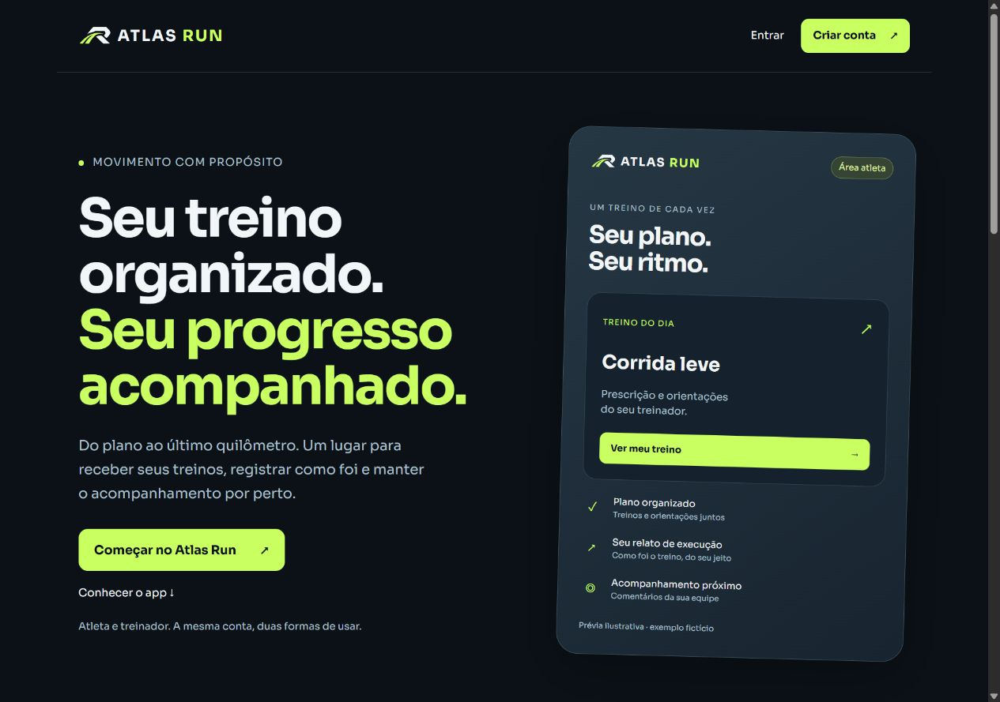

# Atlas Run

Aplicação web para organizar planos de treino e acompanhar sua execução. Treinadores criam ou importam planos, revisam antes de publicar e acompanham os relatos dos atletas.

**JavaScript (ES modules) · PostgreSQL · Supabase · Node.js · Netlify**

[Site publicado](https://atlasrun.netlify.app/) · [Manual de uso](GESTAO.md) · [Testes](tests/) · [Histórico de entregas](HISTORICO.md)

## O que o sistema faz

- Uma conta com áreas de atleta e treinador.
- Importação de planos em CSV, com validação antes da publicação.
- Rascunhos, revisão e versões de planos, preservando o histórico.
- Calendário e registro de execução por sessão.
- Acompanhamento do previsto versus realizado e comentários da equipe.
- Controle de acesso por papel e vínculo entre treinador e atleta.
- No código atual: prescrição de musculação e relato de repetições e carga por série.

## Conheça a interface



A prévia da página inicial usa um exemplo fictício. Os dados da aplicação autenticada dependem da conta e dos vínculos autorizados.

**Versão publicada:** o último registro de publicação, em 19/10/2026, informa que o site principal está na UX-10. A UX-11 de musculação foi integrada ao código e conferida em preview, mas seu deploy de produção ficou bloqueado por créditos da hospedagem. Consulte [o registro de publicação](docs/UX11-HIBRIDO.md#publicação) para os detalhes; o link do site não representa uma confirmação de que todos os recursos da `main` estão em produção.

## Executar localmente

Requisitos: **Node.js 22** e **Python 3.11 ou superior**.

```bash
git clone https://github.com/jovemfelpitos/atlas-21k.git
cd atlas-21k
npm ci
npm start
```

Abra **http://127.0.0.1:4173**. O comando constrói e serve somente a pasta pública `dist/`, com as rotas definidas em `netlify.toml`.

A página inicial e a ajuda podem ser consultadas sem login. A aplicação autenticada usa o backend configurado em `config.js`: clonar o repositório não cria um banco independente. Para usar contas e dados próprios, configure outro projeto conforme [o guia de instalação](HISTORICO.md#configurar-outro-projeto-referência). Os testes abaixo funcionam sem credenciais de produção.

## Testes e build

```bash
npm test
npm run build
```

A suíte usa o test runner nativo do Node.js, Happy DOM e PostgreSQL local em memória via PGlite. Entre os cenários cobertos:

- CSV com aspas, múltiplas linhas, vírgula decimal e dados inválidos;
- permissões entre contas, vínculos revogados e acesso aos planos;
- rascunhos, publicação, preservação de versões e conflitos de edição;
- calendário, valores vazios versus zero e registros de musculação.

O workflow [CI](.github/workflows/ci.yml) executa instalação pelo lockfile, testes e build nos pushes para `main`, nos pull requests e por execução manual. A tarefa usa permissões de leitura e não faz deploy nem executa scripts de validação contra o banco remoto.

## Organização do código

| Caminho | Responsabilidade |
| --- | --- |
| `importer.js` | Leitura de CSV e validação da entrada do plano |
| `plan-editor.js` | Contrato do plano e edição de prescrições |
| `management.js` | Gestão de atletas, rascunhos e publicação |
| `calendar.js`, `activity.js`, `strength.js` | Consulta de sessões e registro do atleta |
| `monitoring.js`, `progress.js` | Acompanhamento e evolução |
| `auth-*.js`, `account-areas.js`, `profile.js` | Acesso, áreas da conta e perfil |
| `supabase/migrations/` | Evolução versionada do banco |
| `netlify/functions/` | Funções de servidor |
| `tests/` | Testes de comportamento, interface e banco local |
| `tools/build-site.js` | Lista explícita dos arquivos do build público |

## Decisões técnicas

**Frontend modular em JavaScript:** módulos nativos para separar as responsabilidades, com build que copia apenas os arquivos públicos previstos.

**Autorização no banco:** papéis e vínculos delimitam o acesso; a escolha de área na interface não concede permissões.

**Publicação versionada:** rascunhos e planos publicados têm fluxos separados, permitindo preservar sessões e relatos das versões anteriores.

**Validação em duas camadas:** a importação verifica estrutura e conteúdo antes da publicação; o banco também impõe as restrições do domínio.

## Documentação

- [Manual de gestão](GESTAO.md)
- [Formato e importação de planos](IMPORTACAO.md)
- [Escopo e matriz de permissões](SPRINTS.md)
- [Musculação: implementação e limites de publicação](docs/UX11-HIBRIDO.md)
- [Histórico completo de entregas e instalação](HISTORICO.md)

## Limites conhecidos

O aceite físico de instalação e alertas em Android/iPhone permanece pendente nos registros do projeto. Testes locais e conferências em navegador não equivalem a esse aceite. Biblioteca de exercícios, múltiplas equipes e cobrança não fazem parte deste escopo.
